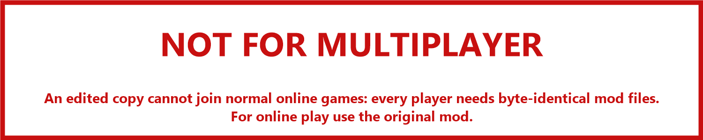
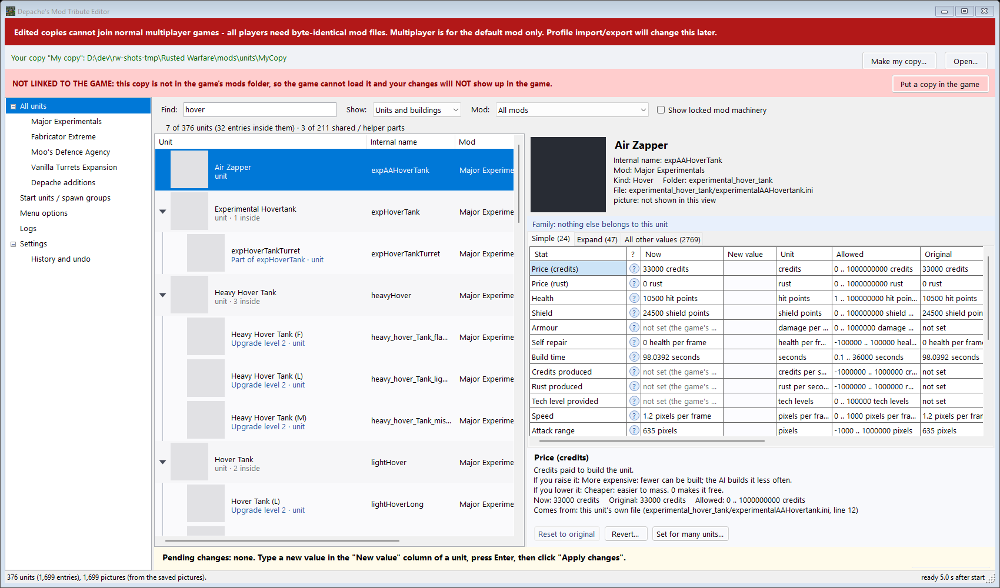
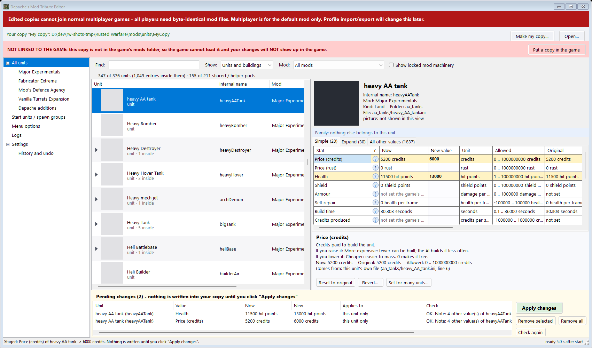
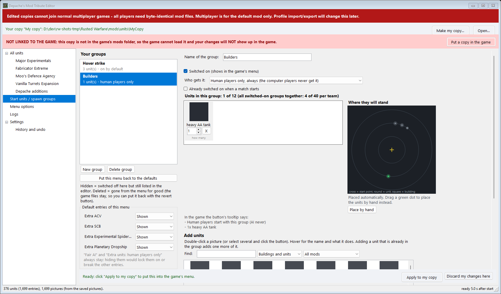
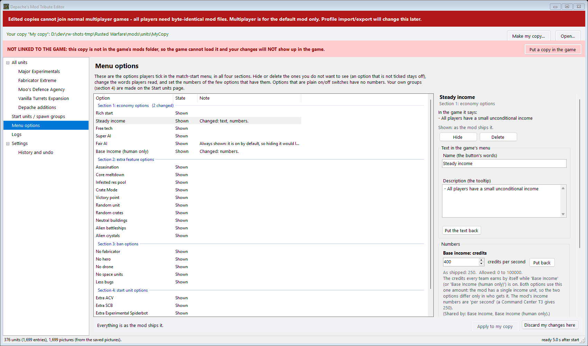
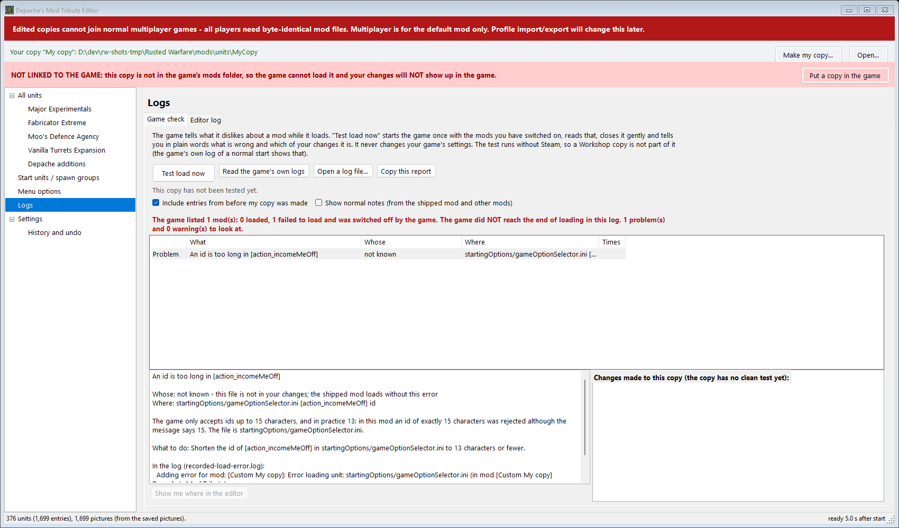
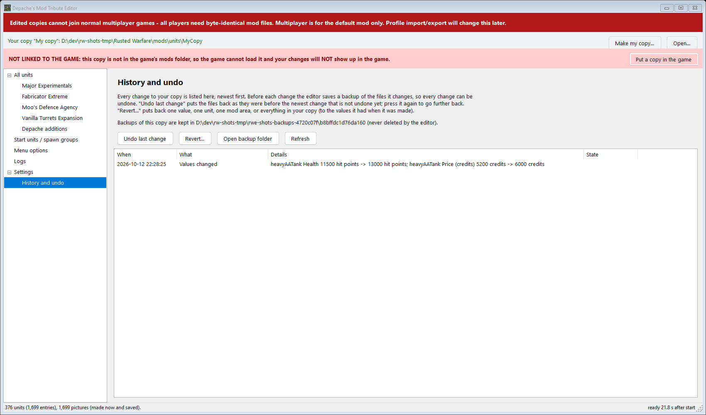

Depache RW Editor
=================

A point-and-click editor for **Depache's Mod Tribute**, the Rusted Warfare mod that brings together MajorExperimentals,
Moo's Defence Agency, Fabricator Extreme and Vanilla Turrets Expansion. Windows only. No install: one program, no mod files inside.

Thank you for downloading this and taking the time to enjoy my work ^_^

*Made by Depache.*

**You do not need this program to play the mod.** It is an extra tool: to have more fun with Depache's Mod Tribute, or to tweak the
setup further to your own taste. Everything in the mod works without it.

Is it safe?
-----------

It was written to be as safe and as clear as possible, and you do not have to take anyone's word for it: everything below can be checked.

* **It changes only your own copy.** The editor makes a separate copy of the mod for you and only that copy is ever changed. The Steam Workshop
  mod is never touched (the editor refuses to write into Workshop folders). Before every change it saves a backup, and *History > Undo* puts it back exactly.
* **It makes no network connections.** The source code contains no networking at all (no ``System.Net``, no web client, no sockets). It has no installer,
  no updater and no hidden parts, and it needs no administrator rights. The only other programs it ever starts are Windows Explorer (to open a folder you
  asked for) and the game's own Java (for *Test load*, which you start yourself).
* **The full source code is here.** Read it, build it yourself with the commands below, and compare. The SHA-256 of each release download is written on its
  release page. To check a download in PowerShell: ``Get-FileHash .\DepacheRwEditor-1.0.0.zip -Algorithm SHA256``
* **It is not code-signed.** Windows may show an "unknown publisher" warning on first run (see *How to use it*). That is why the source is open.
* **The game's own settings are not changed** (``preferences.ini`` is only read, and put back exactly if the game itself rewrites it during a Test load).

Offshoots and other people's versions
-------------------------------------

If someone makes a changed version or an offshoot of this editor, **read its code before you run it.** A program that edits files can do harm in the wrong
hands, and a download from anywhere other than this page is not mine. **I am not responsible for anything I did not make**, including other people's
versions, copies or edits of my work.

What it does
------------

The editor reads your own installed copy of the mod and makes a **separate, editable copy** of it. Only that copy is ever changed.
The original (the Steam Workshop mod) is never touched.

* **Units.** Browse every unit of the four mods, grouped the way they belong together (a unit with its upgrade levels, versions and parts).
  Each value is shown in plain words with a tooltip, where it comes from (the unit's own line, or a shared template and how many units use it),
  and its allowed range. Type new values, check them, and apply them in one go. Change one value for many units at once. Put values back to the
  original one at a time, per unit, per mod or everywhere.
* **Start units.** Build the groups of extra units that players can switch on in the match-start menu: pick units from a grid of pictures, name the
  group, choose who gets it (everyone, or human players only), whether it starts switched on, and drag the green dots to place the units where you
  want them. Hide or delete the default entries you do not want.
* **Menu options.** All options of the match-start menu in its four sections: show, hide or delete each one, change its name and tooltip, and set
  the numbers of the few options that have them (base income, rich start). Options that are plain on/off switches stay switches.
* **Logs.** *Test load* starts the game once, reads what it says while loading and tells you in plain words what is wrong, in which file and line,
  and which of your changes it is. It can also read the game's own log files and crash reports. The editor keeps its own log and crash reports too.

How it keeps your game safe
---------------------------

* Every change goes through one checked path: guards, validation, one backup, one write, read-back. **History > Undo** puts any change back,
  byte for byte, and the editor never writes a value it cannot show.
* Machinery that must always work (the extra-start-unit spawner, the option selector's logic, the economy managers...) is **locked**: the editor
  checks those files against a list of fingerprints, refuses to edit anything on a copy where they differ, and can only change a few whitelisted
  lines of them (the menu texts and numbers), each recorded so it can be undone and verified.
* The editor never changes the game's own settings (``preferences.ini``). It never writes to the Steam Workshop folder.
* Every action runs inside a safety wrapper; if something goes wrong the editor tells you in plain words, keeps running, and saves a crash report.

How to use it
-------------

1. Unzip anywhere and run ``DepacheRwEditor.exe``. Windows may warn that the program is from an unknown publisher (it is not code-signed):
   click *More info*, then *Run anyway*.
2. Click **Make my copy**. The wizard finds your game and the installed mod, asks for a name and a place inside the game's ``mods\units`` folder,
   and copies the mod there. It takes about a minute.
3. Change what you want. Click **Apply**. In the game's *Mods* menu switch your copy **on** and every other copy of Depache's Mod Tribute **off**
   (two copies on at once load every unit twice).
4. Optional: *Logs > Game check > Test load now* checks that the game still loads everything.

Requirements: Windows 10 or 11 (64-bit), Rusted Warfare from Steam, and Depache's Mod Tribute installed. The editor is self-contained; it does not
need .NET installed.

Screenshots
-----------

*Units: values in plain words, with their allowed range and where each one comes from.*

*Typed values wait in the pending list with their checks until you apply them.*

*Start units: build a group and see where its units will stand.*

*Menu options: show, hide, rename, set numbers.*

*Logs: what the game complained about, whose change it is, and what to do.*

*History: every change, with Undo.*

The screenshots show grey boxes where unit pictures would be: the pictures belong to the mods' authors and are not part of this project.

Where things are kept
---------------------

* Editor log and crash reports: ``%LOCALAPPDATA%\DepacheRwEditor\logs``
* Backups for Undo: ``%LOCALAPPDATA%\DepacheRwEditor\backups``
* Results of the last Test load: ``%LOCALAPPDATA%\DepacheRwEditor\testloads``
* Your copy's own list of changes: ``rweditor-settings.json`` inside the copy (a plain, readable file)

Building from source
--------------------

Needs the .NET 10 SDK on Windows. From the repository folder::

    dotnet build RwEditor.sln -c Release
    dotnet test RwEditor.sln -c Release
    dotnet publish src/RwEditor.App -c Release -r win-x64 --self-contained -p:PublishSingleFile=true -p:EnableCompressionInSingleFile=true -p:IncludeNativeLibrariesForSelfExtract=true -o dist

The solution has four projects: ``RwEditor.Core`` (all rules, no user interface), ``RwEditor.App`` (the Windows program), ``RwEditor.Cli`` (``rwedit``,
the same rules on the command line) and ``RwEditor.Tests``. The data the editor ships with (the stat dictionary, the mod-area list, the menu-option
whitelist and the shipped-mod log baseline) is in ``data/`` and is embedded into the program. The tests that need the mod's own source tree are skipped
when it is not next to the editor.

Before pushing changes, run ``tools/check-no-md.ps1`` (it also runs as the repository's pre-push hook: ``git config core.hooksPath .githooks``).

Credits
-------

Depache's Mod Tribute is a collaboration of four mods by their authors; see the mod's Workshop page for who made what. This editor is an
independent tool and contains none of their files.

License
-------

Copyright (c) 2026 Depache. All rights reserved. The program is free to download and use. See ``LICENSE.txt``.
